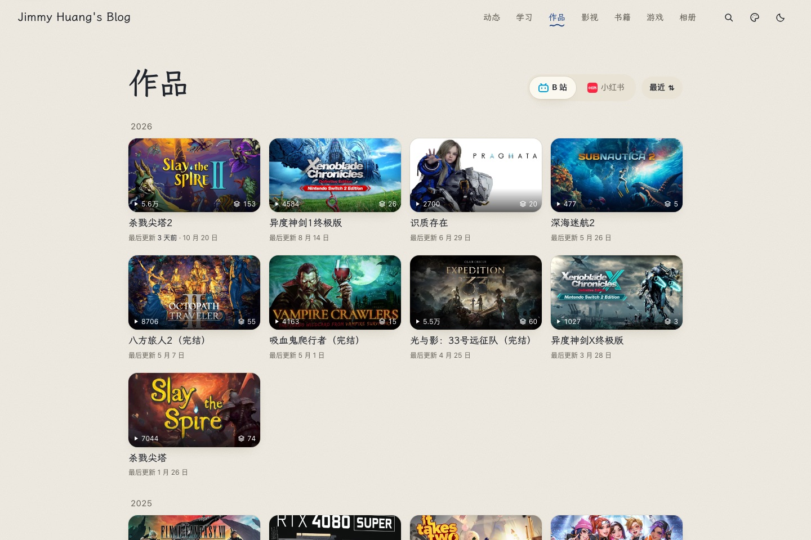
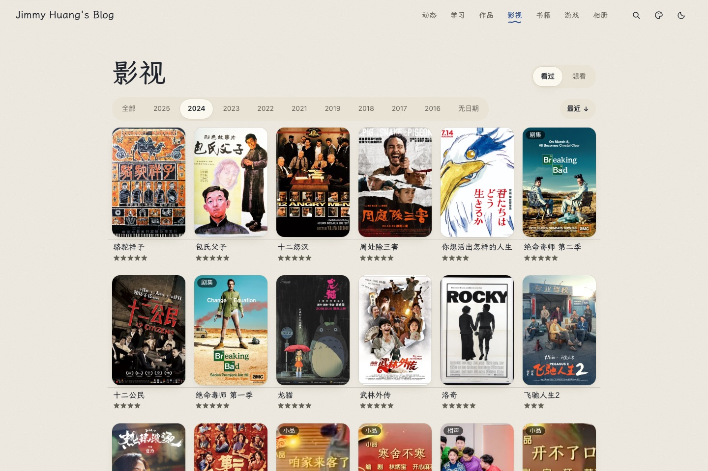
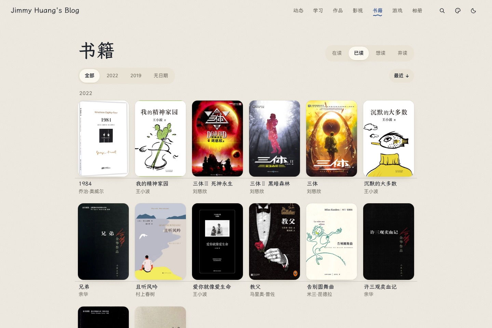
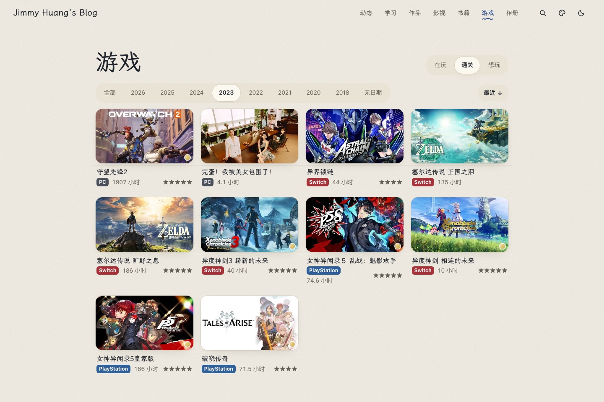
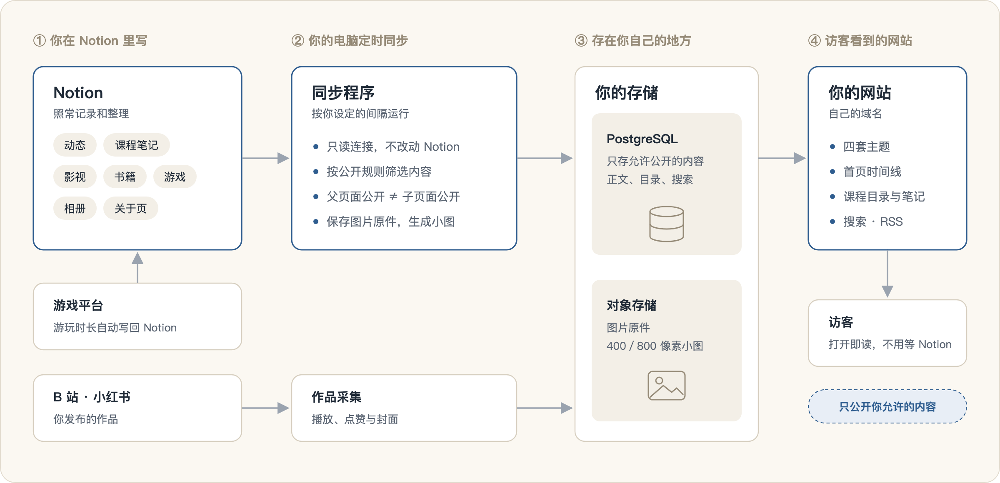

<div align="center">

<h1>NotionBlog</h1>

<p><strong>以 Notion 为内容后台的个人网站。</strong></p>

<p>同步程序通过 Notion API 只读拉取你指定的数据库，按每个来源的公开规则筛选，子页面不随父页面公开；<br />正文写入 PostgreSQL，图片转存到对象存储。Next.js 网站只从这里读取，渲染成动态、课程笔记、书影游和相册页面。</p>

<p>
  <a href="LICENSE"></a>
  <a href="package.json"></a>
  <a href="package.json"></a>
  <a href="tsconfig.json"></a>
</p>

<p>
  <a href="#为什么需要它">为什么需要它</a> ·
  <a href="#功能一览">功能</a> ·
  <a href="#快速开始">快速开始</a> ·
  <a href="#接入自己的-notion">接入 Notion</a> ·
  <a href="#项目状态">项目状态</a> ·
  <a href="docs/README.md">文档</a>
</p>

</div>


<p align="center"><sub>截图来自离线演示，内容都是虚构的。</sub></p>

## 为什么需要它

Notion 适合记录，却不适合直接给人看。把页面“发布到网页”，很快就会碰到这些问题：

| 直接分享 Notion 页面 | 用 NotionBlog |
| --- | --- |
| **公开一页，下面的子页面也能被点开**，私人笔记容易被顺带看到。 | 每个来源单独设公开规则，**父页面公开不代表子页面公开**。没公开的链接点不了，也不会跳回你的 Notion。 |
| **一看就是 Notion**，域名也不是你的。 | 四套主题和深色模式，绑定你自己的域名。 |
| **打开慢**，有些网络下干脆打不开。 | 内容提前同步到你自己的数据库，打开页面不用等 Notion。 |
| **图片链接一小时就过期**，转发出去很快变成裂图。 | 图片存原件、走站内地址，不会过期；列表用小图，加载更快。 |
| **课程笔记层级一深**，读者点几层就迷路。 | 保留“学期 → 课程 → 周次 → 知识点”，有目录树、面包屑和上一篇／下一篇。 |
| **动态、书影游、作品散在各处。** | 首页一条时间线全串起来，每个栏目也能单独看。 |

内容照旧在 Notion 里写，NotionBlog 只把你允许公开的部分做成网站。

## 功能一览

### 一条时间线，装下日常

首页以动态为主线，穿插你看过的电影、读完的书、玩过的游戏、新的相册，还有发在 B 站和小红书的作品。动态可以展开全文、点开大图，也能按年份往回翻。

### 书影游与作品，各有专门的页面

影视、书籍、游戏按年份分组，可以按状态和年份筛选；游戏卡片带平台、游玩时长和评分，作品页显示播放量和集数。下面是作者自己网站上的真实页面：

<table>
  <tr>
    <td width="50%" align="center"><strong>作品 · B 站视频与合集</strong><br /></td>
    <td width="50%" align="center"><strong>影视 · 按年份筛选</strong><br /></td>
  </tr>
  <tr>
    <td width="50%" align="center"><strong>书籍 · 封面与作者</strong><br /></td>
    <td width="50%" align="center"><strong>游戏 · 平台、时长与评分</strong><br /></td>
  </tr>
</table>

### 课程笔记，按原来的层级读

笔记在 Notion 里怎么嵌套，网站上就怎么排。左边是课程目录，正文旁有页内目录，读完一篇直接点下一篇。


### 正文排版

支持 17 种 Notion 正文块：代码高亮、数学公式、表格、分栏、折叠、提示框、待办……图片点开能看大图。

<details>
<summary><strong>看看正文效果</strong></summary>


运行演示后打开 [`/preview/blocks`](http://127.0.0.1:3000/preview/blocks) 就能看到。

</details>

### 四套主题

墨水、苹果、岛屿、千禧，在页头一键切换。前三套还有深色模式。

<table>
  <tr>
    <td width="50%" align="center"><strong>墨水 · 暖纸与蓝黑笔迹</strong><br /></td>
    <td width="50%" align="center"><strong>苹果 · 清爽与克制</strong><br /></td>
  </tr>
  <tr>
    <td width="50%" align="center"><strong>岛屿 · 明快与轻松</strong><br /></td>
    <td width="50%" align="center"><strong>千禧 · 蓝色网格与气泡</strong><br /></td>
  </tr>
</table>

### 搜索与分享

按 `/` 或 `⌘K` 随时搜索。自带 RSS 和站点地图，分享链接时会带上标题、摘要和封面。

## 快速开始

装好 **Node.js 24 LTS**，四行命令就能在本机看到完整网站，不需要 Notion 账号、数据库或任何云服务：

```sh
git clone https://github.com/jimmyhuang22/NotionBlog.git
cd NotionBlog
npm ci
npm run dev
```

打开 **[http://127.0.0.1:3000](http://127.0.0.1:3000)**，逛逛首页、[动态](http://127.0.0.1:3000/status)和[学习区](http://127.0.0.1:3000/study)，换换主题。演示用的都是虚构数据，不会连接任何真实来源。

<details>
<summary><strong>常用命令</strong></summary>

| 命令 | 用途 |
| --- | --- |
| `npm run dev` | 启动离线演示 |
| `npm run dev -- --port 3100` | 换一个端口 |
| `npm run check` | 类型、测试与隐私检查 |
| `npm run build` | 生产构建 |
| `npm start` | 运行本机构建 |

跑 `npm run check` 前，还要装一次游戏同步工具的依赖：`npm ci --prefix scripts/game-sync --ignore-scripts`。

本机开发默认和真实数据隔离：就算有 `.env.local`，也不会连到真实来源。需要真实联调时见[开发隔离](docs/DEVELOPMENT_ISOLATION.md)。

</details>

## 接入自己的 Notion

### 1. 把内容整理成 Notion 数据库

网站按数据库读取：每类内容一个数据库，例如动态、课程、游戏、影视、书籍，每条记录一行。课程笔记放在课程页面下的笔记数据库里，笔记下面的子页面照原样嵌套就行。

列名不用照着改：在配置里写明哪一列是标题、哪一列是日期、哪一列是评分即可，格式见[来源示例](config/notion-website.example.json)。

还没在 Notion 里的旧记录（比如在其他网站标记过的书和电影、零散的笔记），要先导进去。Notion 可以直接导入 CSV，也可以先让 AI 帮你整理成表格，再批量导入。

### 2. 连接 Notion，选择公开范围

在 Notion 里建一个只读连接，只授权需要展示的数据库，再给每个来源设好公开规则。步骤见 [Notion 接入指南](docs/NOTION_SETUP.md)。

### 3. 填写个人资料

参照[站点配置示例](config/site.example.json)填名称、简介、头像、社交链接和时区；有哪些栏目可以打开，见 [config/features.ts](config/features.ts)。真实配置放在被 Git 忽略的 `config/site.json`，不会进仓库。

### 4. 运行同步，上线网站

**数据库不用手动导入。** 同步程序第一次运行时，会把允许公开的内容全部写进 PostgreSQL，之后按你设定的间隔自动更新。网站目前用 Vercel 部署，只读数据库。步骤见[数据库接入](docs/WEBSITE_DATABASE_SETUP.md)、[同步程序](docs/NOTION_SYNC_WORKER.md)和[部署说明](docs/VERCEL_SUPABASE_TRIAL.md)。

| 读取方式 | 什么时候用 |
| --- | --- |
| `mock` | 离线演示，默认使用 |
| `notion` | 本机直接读 Notion，核对字段和公开规则 |
| `database` | 正式上线，网站只读你的 PostgreSQL |

## 内容怎样到达页面

<picture>
  <source media="(prefers-color-scheme: dark)" srcset="docs/assets/readme/architecture-dark.png" />
  
</picture>

公开与否在同步和读取时就判断好，网站拿到的只有允许公开的内容。缺日期、封面或评分时如实留空，不会编造。

<details>
<summary><strong>工程目录</strong></summary>

```text
contracts/              内容格式与接口约定
src/app/                页面与 API
src/components/         组件、主题与阅读交互
src/lib/content/        页面使用的统一内容入口
src/server/             Notion、数据库、公开规则与图片处理
scripts/                同步程序与开发工具
database/               数据库结构与权限
supabase/migrations/    数据库迁移
config/                 配置示例与栏目开关
fixtures/               虚构演示内容
tests/                  测试
```

</details>

## 项目状态

作者自己的网站已经在用它：首页、动态、学习、作品、影视、书籍、游戏、相册都是真实数据。博客和项目页面做好了，还没接真实数据。

还没有稳定版本，配置可能会变；也没有一键部署，上线要自己配好 Notion 连接、数据库和同步程序。源码已按 MIT 许可证公开；个人内容、真实配置与运行凭据不包含在仓库中。

**适合你，如果**已经在 Notion 里记录动态、课程笔记或书影游，想要一个自己的网站，在意哪些内容能被看到，也愿意自己部署。

**暂时不适合，如果**只想点一下就上线，或只需要一个简单博客——Notion 自带的发布会更省事。

## 更多文档

| 我想…… | 看这里 |
| --- | --- |
| 看全部文档 | [文档导航](docs/README.md) |
| 设置课程笔记的公开规则 | [学习区规则](docs/STUDY_PUBLICATION.md) |
| 改页面、主题或正文样式 | [前端开发指南](docs/FRONTEND_GUIDE.md) |
| 同步游戏时长或社交作品 | [游戏同步](docs/GAME_ACCOUNT_SYNC.md)、[社交同步](docs/SOCIAL_SYNC.md) |
| 处理图片与小图 | [图片与小图](docs/MEDIA_THUMBNAILS.md) |
| 了解同步、部署与回退 | [同步运行](docs/WEBSITE_SYNC_RUNTIME.md)、[上线与恢复](docs/REFACTOR_ROLLOUT.md) |
| 了解隐私约定 | [隐私约定](docs/PRIVACY.md) |

## 常见问题

**会把我整个 Notion 工作区公开吗？** 不会。网站只读你授权给只读连接的数据库，再按每个来源的公开规则筛一遍。父页面、链接、提及和关系都不会把别的内容带出来。

**为什么演示里只有动态和学习？** 这是默认打开的栏目。影视、书籍、游戏、相册、作品要接上你自己的数据后再打开。

**以后不想用 Notion 了怎么办？** 页面只认统一的内容格式，不直接读 Notion。正式上线后网站读的是你自己的 PostgreSQL，以后换一种写作方式，页面不用重做。

## 参与开发

先看 [AGENTS.md](AGENTS.md) 和[项目需求](docs/REQUIREMENTS.md)。改动走短期分支合进 `develop`，正式发布由 `develop` 合进 `main`。

改了代码请跑 `npm run check` 和 `npm run build`。提问题时附上复现步骤、Node 版本和去掉隐私的报错，不要贴真实配置、密钥或个人正文。

## 许可

源码采用 [MIT License](LICENSE)。个人内容、头像和真实站点资料不在授权范围内；截图里的影视、书籍、游戏封面归各自的版权方所有；第三方依赖、字体和媒体遵守各自的许可。
