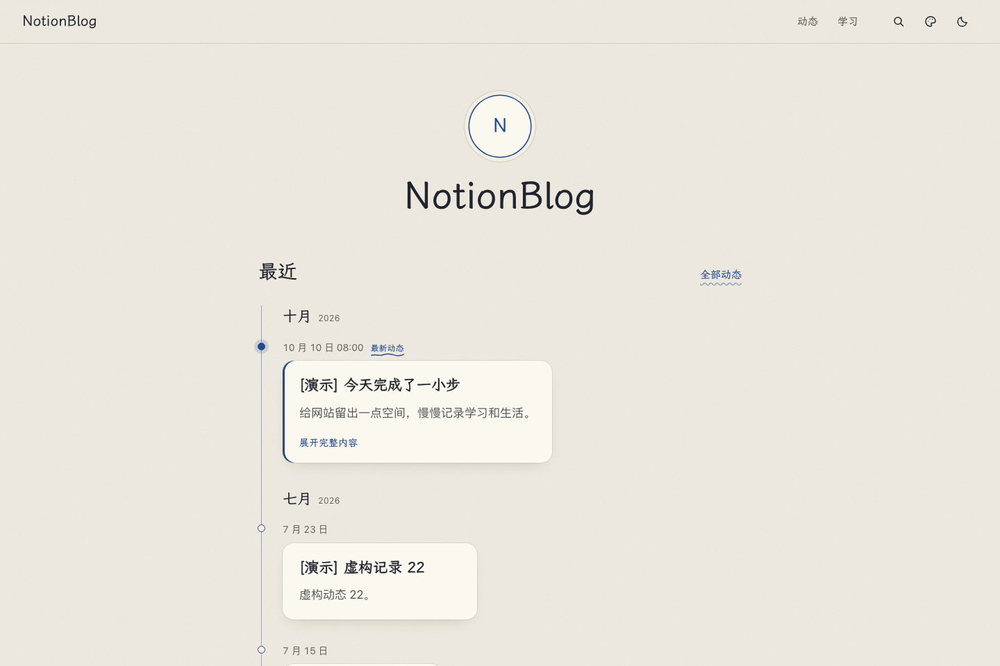
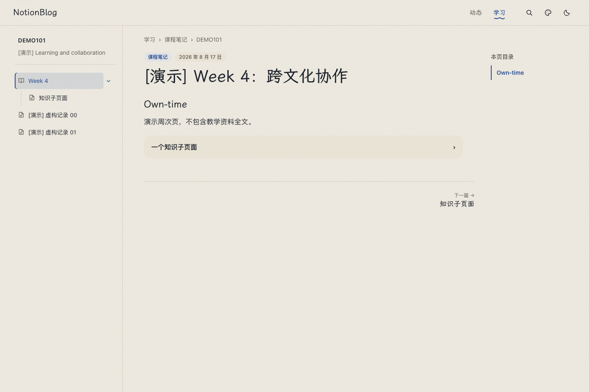
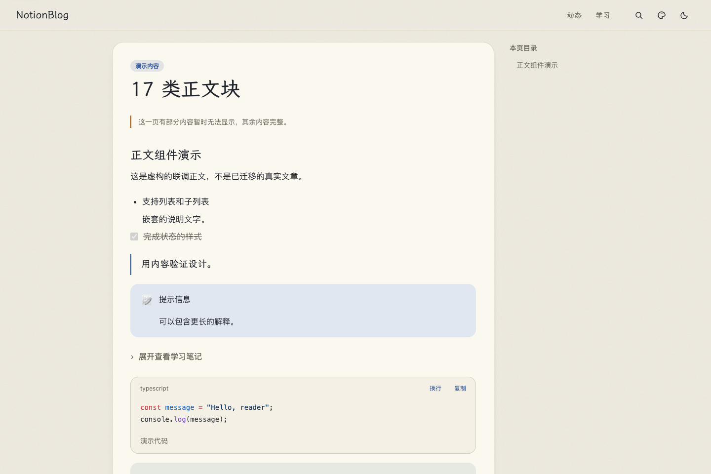
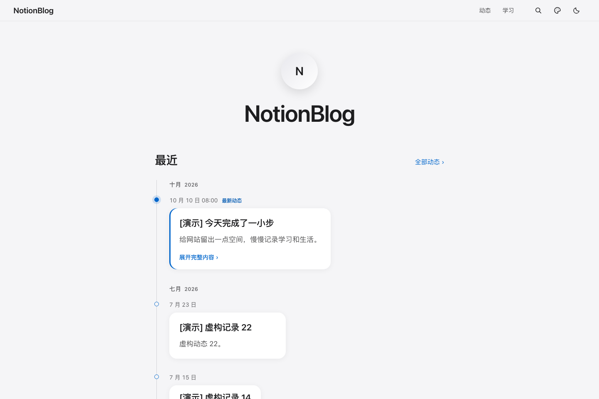
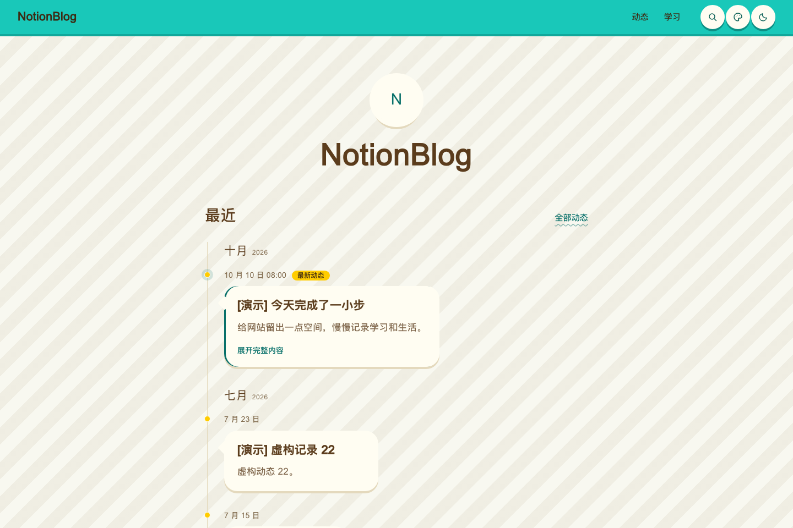
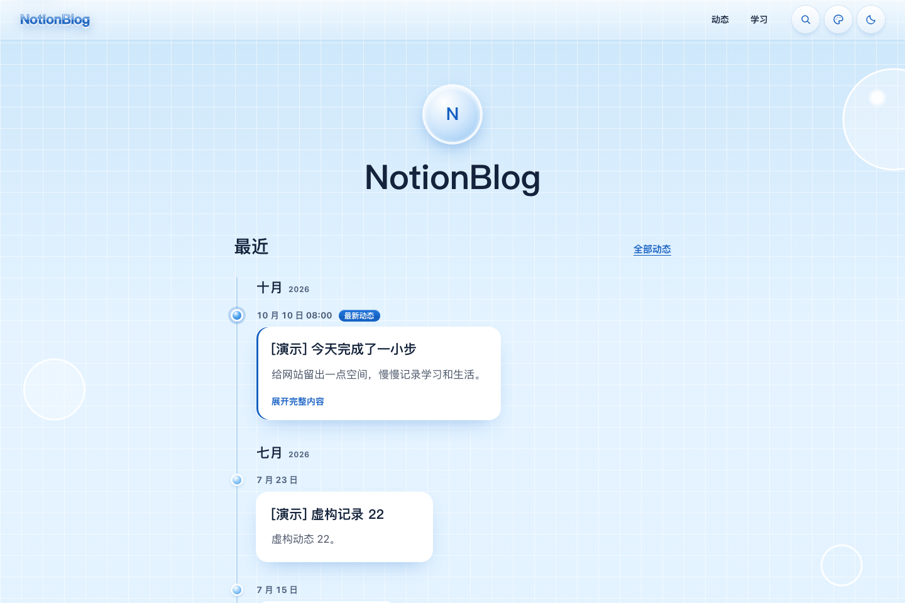
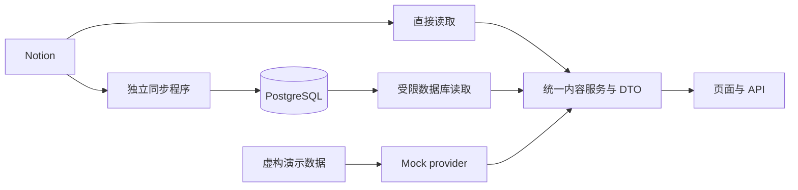

<div align="center">

<h1>NotionBlog</h1>

<p><strong>在 Notion 记录，让日常与学习有自己的展示方式。</strong></p>

<p>时间线、层级笔记、作品与收藏，汇入一个可定制的个人网站。<br />内容继续在 Notion 中维护，阅读体验由自己掌握。</p>

<p>
  <a href="LICENSE"></a>
  <a href="package.json"></a>
  <a href="package.json"></a>
  <a href="tsconfig.json"></a>
</p>

<p>
  <a href="#你可以用它做什么">功能</a> ·
  <a href="#主题预览">主题预览</a> ·
  <a href="#快速开始">快速开始</a> ·
  <a href="#接入自己的内容">接入内容</a> ·
  <a href="docs/README.md">文档</a>
</p>

</div>



<p align="center"><sub>本页截图均来自本机离线演示，使用虚构记录、通用身份和本地素材。</sub></p>

## 你可以用它做什么

**记下日常，也留住学习的来路。** NotionBlog 适合希望把动态、课程笔记和个人收藏放在同一网站中的人：既能快速浏览最近的记录，也能沿着课程与目录读进一份长笔记。

| 场景 | 网站如何呈现 |
| --- | --- |
| **记录日常** | 按时间浏览动态，展开正文，通过年份筛选回顾旧记录；获准的社交作品与合集可接入首页时间线。 |
| **整理学习** | 保留学习项目 → 学期 → 课程 → 周次／活动 → 知识子页面的层级，提供目录树、面包屑和笔记间导航。 |
| **认真阅读** | 支持代码高亮、数学公式、表格、分栏、图片预览与看大图；站内搜索帮助找回已有内容。 |
| **展示作品与收藏** | 社交作品、游戏、影视、书籍、相册和项目使用对应页面与统一内容接口，按配置接入。 |
| **换一种网站气质** | 在墨水、苹果、岛屿与千禧主题之间切换，支持适用主题的明暗模式与响应式布局。 |

默认演示启用**动态与学习区**。其他栏目、真实来源和同步能力按各自配置启用；栏目出现在导航中，不代表其所有内容都获得公开资格。

### 从目录走进笔记

学习页保留内容原有的父子关系。进入笔记后，可以通过侧边目录、页面内目录和上一篇／下一篇继续阅读。



<details>
<summary><strong>查看正文组件预览</strong>：代码、列表、表格、公式等</summary>



运行演示后，可访问 [`/preview/blocks`](http://127.0.0.1:3000/preview/blocks) 查看正文渲染。此预览仅在 `mock` 模式下提供。

</details>

## 主题预览

四套主题共用同一份内容与页面结构，可通过网站右上角的主题菜单切换。

<table>
  <tr>
    <td width="50%" align="center"><strong>墨水 · 暖纸与蓝黑笔迹</strong><br /></td>
    <td width="50%" align="center"><strong>苹果 · 清爽与克制</strong><br /></td>
  </tr>
  <tr>
    <td width="50%" align="center"><strong>岛屿 · 明快与轻松</strong><br /></td>
    <td width="50%" align="center"><strong>千禧 · 蓝色网格与气泡</strong><br /></td>
  </tr>
</table>

墨水、苹果与岛屿提供浅色／深色模式；千禧使用固定浅色方案。截图展示各主题的浅色演示状态，取景与来源见[截图说明](docs/assets/readme/README.md)。

## 快速开始

准备 **Node.js 24 LTS** 与 npm，先运行不需要任何云账号的本机演示：

```sh
git clone https://github.com/jimmyhuang22/NotionBlog.git
cd NotionBlog
npm ci
npm run dev
```

打开 **[http://127.0.0.1:3000](http://127.0.0.1:3000)**，即可浏览首页、[动态](http://127.0.0.1:3000/status)和[学习区](http://127.0.0.1:3000/study)，也可以切换主题、搜索演示内容。

演示使用虚构数据与本地图片，无需 Notion Token、数据库或对象存储。首次安装依赖需要访问 npm registry；离线时外部字体可能使用系统字体回退。

<details>
<summary><strong>常用命令与完整验证</strong></summary>

游戏平台同步工具有独立锁文件，运行完整检查前还需安装其依赖：

```sh
npm ci --prefix scripts/game-sync --ignore-scripts
```

| 命令 | 用途 |
| --- | --- |
| `npm run dev` | 启动隔离的离线演示 |
| `npm run dev -- --port 3100` | 使用其他本机端口 |
| `npm run check` | 类型、协议、测试与源码隐私检查 |
| `npm run build` | 生产构建与服务端追踪隐私检查 |
| `npm start` | 启动本机构建，仍使用隔离演示 |
| `npm run privacy:check -- --staged` | 检查实际暂存内容 |

普通开发、测试、本机构建与启动会隔离真实环境输入。已有 `.env.local` 或单独修改 `CONTENT_PROVIDER`，不会自动接通生产来源。真实联调使用[独立受限入口](docs/DEVELOPMENT_ISOLATION.md)。完整 Node 版本约束见 [package.json](package.json)。

</details>

## 接入自己的内容

先运行演示，再选择内容读取方式。三种 provider 共用内容契约与页面组件。

| 方式 | 用于什么 | 从哪里开始 |
| --- | --- | --- |
| **`mock` · 离线演示** | 体验页面、调整前端、运行回归检查 | 默认启用 |
| **`notion` · 直接读取** | 核对自己的来源字段、正文及公开规则 | [Notion 接入指南](docs/NOTION_SETUP.md) |
| **`database` · 数据库读取** | 独立同步程序采集内容，网站通过受限 reader 读取 PostgreSQL | [数据库接入](docs/WEBSITE_DATABASE_SETUP.md) → [同步运行](docs/NOTION_SYNC_WORKER.md) |

接入可分三步进行：

1. **配置来源与公开范围。** 按接入指南映射字段、选择来源，核对学习页父链与撤回规则。[来源示例](config/notion-sources.example.json)与[网站来源示例](config/notion-website.example.json)只描述格式。
2. **设置个人资料与栏目。** 参照[站点配置示例](config/site.example.json)设置名称、简介、头像、社交链接、时区及学习项目；栏目定义见 [config/features.ts](config/features.ts)。真实值保存在忽略的 `config/site.json` 或服务端 `SITE_CONFIG_JSON` 中。
3. **验证读取，再安排上线。** 确认正文、目录、媒体和撤回行为，再按[部署与恢复指南](docs/REFACTOR_ROLLOUT.md)接线。网站 reader 与内容、游戏、社交、媒体任务分别使用受限凭据。

当前托管接入以 Vercel 为主，数据库使用 PostgreSQL，媒体通过可替换的存储适配访问。真实上线需要配置来源、权限、数据库及相关任务，**目前没有一键建库或一键部署流程**。具体接入步骤见[部署试验说明](docs/VERCEL_SUPABASE_TRIAL.md)。

## 内容怎样到达页面



页面只消费统一 DTO；采集、公开资格、数据库读取与媒体处理保留在服务端。真实 provider 失败会明确报错，未知日期、评分和封面保留 `null`。

<details>
<summary><strong>工程目录</strong></summary>

```text
contracts/              内容 DTO、正文 AST 与接口契约
src/app/                页面路由与 API
src/components/         组件、主题与阅读交互
src/lib/content/        前端使用的统一内容入口
src/server/             Notion、数据库、公开资格与媒体实现
scripts/                独立同步任务与开发验证工具
database/               数据库协议与权限
supabase/migrations/    增量迁移
config/                 通用配置示例与栏目定义
fixtures/               虚构演示内容
tests/                  契约、权限、同步、读取与隐私回归
```

</details>

## 按需要继续阅读

| 我想…… | 文档入口 |
| --- | --- |
| 了解全部文档与接入顺序 | [文档导航](docs/README.md) |
| 配置学习项目与笔记公开规则 | [学习区规则](docs/STUDY_PUBLICATION.md) |
| 修改页面、主题或正文渲染 | [前端开发指南](docs/FRONTEND_GUIDE.md) |
| 接入游戏账户或社交作品 | [游戏同步](docs/GAME_ACCOUNT_SYNC.md)、[社交同步](docs/SOCIAL_SYNC.md) |
| 处理图片与缩略图 | [媒体与预览](docs/MEDIA_THUMBNAILS.md) |
| 了解同步、部署与回退 | [同步运行器](docs/WEBSITE_SYNC_RUNTIME.md)、[重构交接](docs/REFACTOR_ROLLOUT.md) |
| 核对隐私与源码公开准备 | [隐私约定](docs/PRIVACY.md)、[公开准备](docs/PUBLIC_READINESS.md) |

## 常见问题

**为什么刚启动时只看到动态与学习？** 这是默认演示范围。作品库、社交作品等能力需要相应配置和已授权来源；运行同步任务也不是体验网站的前提。

**可以把整个 Notion 工作区直接展示出来吗？** 接入按配置的来源与对应公开规则进行。父页、普通链接、提及和关系不自动授权关联内容；来源授权与导航栏目开关分别管理。

**现在适合直接作为通用部署模板吗？** 当前仍在持续开发，尚未发布稳定版本。已实现的可选能力可能有独立安装步骤与开关，部署前应按所选 provider 验证自己的环境。当前仓库保持私人，获取代码需要相应访问权限。

## 参与开发

从 [AGENTS.md](AGENTS.md)、[项目需求](docs/REQUIREMENTS.md)与相关[决策](docs/decisions/README.md)开始。改动通过短期分支提交到 `develop`；正式发布走 `develop → main` 的发布 PR。

应用改动运行 `npm run check` 与 `npm run build`；纯文档改动按影响验证记录、链接、差异与隐私。反馈问题时请附复现步骤、Node 版本和脱敏错误信息，避免提交真实配置、凭据、数据库导出或个人正文。

## 许可

项目原创源码采用 [MIT License](LICENSE)。个人内容、头像与真实站点资料不随源码自动授权；第三方依赖、字体和媒体遵守各自许可。
