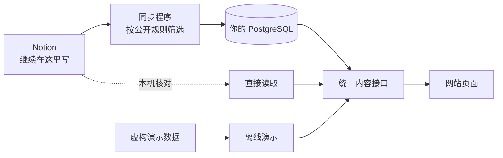

<div align="center">

<h1>NotionBlog</h1>

<p><strong>继续在 Notion 里写，访客看到的是一个真正属于你的网站。</strong></p>

<p>动态、课程笔记、书影游、相册，连同发在 B 站和小红书的作品，汇成一个快速、好看的个人网站。<br />只公开你允许的内容——不再是 notion.site，也不用担心子页面被一起看见。</p>

<p>
  <a href="LICENSE"></a>
  <a href="package.json"></a>
  <a href="package.json"></a>
  <a href="tsconfig.json"></a>
</p>

<p>
  <a href="#为什么需要它">为什么需要它</a> ·
  <a href="#功能一览">功能</a> ·
  <a href="#快速开始">快速开始</a> ·
  <a href="#接入自己的-notion">接入 Notion</a> ·
  <a href="#项目状态">项目状态</a> ·
  <a href="docs/README.md">文档</a>
</p>

</div>


<p align="center"><sub>截图来自本机离线演示：虚构记录、通用身份、本地素材。克隆后一条命令就能看到同样的页面。</sub></p>

## 为什么需要它

Notion 很适合记录，却不太适合拿来给别人看。把页面直接“发布到网页”，很快会碰到这些问题：

| 直接分享 Notion 页面时 | NotionBlog 的做法 |
| --- | --- |
| **公开一个页面，下面的子页面也跟着能被打开**，私人笔记容易被顺带看到。 | 每个来源单独设定公开规则：**父页面公开不代表子页面公开**。没公开的链接显示为不可点击，绝不跳回你的 Notion。 |
| **看上去就是 Notion**：同样的界面、同样的域名，很难有自己的风格。 | 四套主题与明暗模式，动态、课程、书影游、相册、作品各有专门设计的页面。 |
| **打开要加载整个 Notion 页面应用**，在部分网络环境下又慢又不稳定。 | 可由独立同步程序把已发布内容存进你自己的 PostgreSQL，访客打开页面时不用等 Notion。 |
| **图片链接会过期**，转存到别处后还容易失效。 | 图片走站内地址，原图可放进自己的对象存储，列表与封面使用 400／800 像素小图。 |
| **层级很深的课程笔记**，分享出去后读者只能一页页点进去，很快迷路。 | 保留“学期 → 课程 → 周次 → 知识点”的层级，提供目录树、面包屑和上一篇／下一篇。 |
| **生活散落在各处**：动态在一个库、书影游在另一个库，作品发在别的平台。 | 首页一条时间线串起动态、书影游、相册更新和外部平台作品，各栏目也能单独浏览。 |

内容仍在 Notion 中维护，表格、关系、汇总和富文本编辑照常使用；NotionBlog 只负责把你允许公开的部分，变成好读的网站。

## 功能一览

### 一条时间线，装下日常

首页以动态为主线，按时间穿插影视、书籍、游戏、相册的更新，以及发在 B 站、小红书的作品与合集（附播放或点赞数）。动态可展开正文、查看图片，也能按年份回看。

### 课程笔记，按原来的层级读

学习区保留笔记在 Notion 中的父子关系。进入一篇笔记后，可以沿侧边目录、页内目录和上一篇／下一篇连续阅读。


### 认真排版的正文

支持 17 类 Notion 正文块：代码高亮、数学公式、表格、分栏、折叠、提示框、待办、目录等，图片可点开看大图。

<details>
<summary><strong>查看正文组件预览</strong></summary>


运行演示后访问 [`/preview/blocks`](http://127.0.0.1:3000/preview/blocks) 即可查看，此页只在离线演示中提供。

</details>

### 四套主题，一键切换

同一份内容、同一套页面结构，从页头的主题菜单切换。墨水、苹果、岛屿有浅色和深色，千禧只有浅色。

<table>
  <tr>
    <td width="50%" align="center"><strong>墨水 · 暖纸与蓝黑笔迹</strong><br /></td>
    <td width="50%" align="center"><strong>苹果 · 清爽与克制</strong><br /></td>
  </tr>
  <tr>
    <td width="50%" align="center"><strong>岛屿 · 明快与轻松</strong><br /></td>
    <td width="50%" align="center"><strong>千禧 · 蓝色网格与气泡</strong><br /></td>
  </tr>
</table>

<sub>截图取景与来源见[截图说明](docs/assets/readme/README.md)。</sub>

### 找得到，也分享得出去

- **站内搜索**：按栏目筛选、结果高亮；任意页面按 `/` 或 `⌘K` 呼出快捷搜索。
- **订阅与收录**：自带 RSS、站点地图和 robots，分享链接时带上标题、摘要和封面。
- **缺什么就说什么**：没有日期、封面、评分或正文时如实显示，不编造；加载失败只影响出错的那一块，可以重试。

## 快速开始

准备 **Node.js 24 LTS** 与 npm，不需要 Notion 账号、数据库或任何云服务：

```sh
git clone https://github.com/jimmyhuang22/NotionBlog.git
cd NotionBlog
npm ci
npm run dev
```

打开 **[http://127.0.0.1:3000](http://127.0.0.1:3000)**，就能浏览首页、[动态](http://127.0.0.1:3000/status)和[学习区](http://127.0.0.1:3000/study)，切换主题、搜索演示内容。

演示只用虚构数据与本地图片，不会连接任何真实来源。首次安装依赖需要访问 npm registry；离线时外部字体会回退到系统字体。

<details>
<summary><strong>常用命令与完整验证</strong></summary>

游戏平台同步工具有独立锁文件，运行完整检查前还需安装其依赖：

```sh
npm ci --prefix scripts/game-sync --ignore-scripts
```

| 命令 | 用途 |
| --- | --- |
| `npm run dev` | 启动隔离的离线演示 |
| `npm run dev -- --port 3100` | 使用其他本机端口 |
| `npm run check` | 类型、协议、测试与源码隐私检查 |
| `npm run build` | 生产构建与服务端追踪隐私检查 |
| `npm start` | 启动本机构建，仍使用隔离演示 |
| `npm run privacy:check -- --staged` | 检查实际暂存内容 |

普通开发、测试、本机构建与启动会隔离真实环境输入：即使已有 `.env.local` 或改了 `CONTENT_PROVIDER`，也不会自动接通真实来源。真实联调使用[独立受限入口](docs/DEVELOPMENT_ISOLATION.md)。完整 Node 版本约束见 [package.json](package.json)。

</details>

## 接入自己的 Notion

先跑通演示，再决定网站从哪里读内容。三种方式共用同一套页面，切换时不用改前端。

| 方式 | 适合 | 从哪里开始 |
| --- | --- | --- |
| **`mock` · 离线演示** | 体验页面、调整样式、跑回归检查 | 默认启用 |
| **`notion` · 直接读取** | 在本机核对自己的字段、正文和公开规则 | [Notion 接入指南](docs/NOTION_SETUP.md) |
| **`database` · 数据库读取** | 正式上线：同步程序定时把已发布内容写入 PostgreSQL，网站只读数据库 | [数据库接入](docs/WEBSITE_DATABASE_SETUP.md) → [同步运行](docs/NOTION_SYNC_WORKER.md) |

接入分三步：

1. **连接 Notion，划定公开范围。** 创建只读连接，只授权需要的数据库，再为每个来源写公开规则。格式见[来源示例](config/notion-sources.example.json)与[网站来源示例](config/notion-website.example.json)。
2. **填写个人资料，选择栏目。** 参照[站点配置示例](config/site.example.json)设置名称、简介、头像、社交链接、时区和学习项目；栏目开关见 [config/features.ts](config/features.ts)。真实值放在被忽略的 `config/site.json` 或服务端 `SITE_CONFIG_JSON`，不进仓库。
3. **核对后上线。** 确认正文、目录、图片和下架行为，再按[部署与恢复指南](docs/REFACTOR_ROLLOUT.md)接线。网站与各个同步任务分别使用权限受限的凭据。

目前以 Vercel 托管网站、PostgreSQL 存内容，图片存储可替换。具体步骤见[部署试验说明](docs/VERCEL_SUPABASE_TRIAL.md)。

## 内容怎样到达页面



公开资格、数据库读取与图片处理都在服务端完成，页面只拿到已经允许公开的内容。来源出错时明确报错，不会悄悄换成演示数据；未知的日期、评分和封面保持为空。

<details>
<summary><strong>工程目录</strong></summary>

```text
contracts/              内容 DTO、正文 AST 与接口契约
src/app/                页面路由与 API
src/components/         组件、主题与阅读交互
src/lib/content/        前端使用的统一内容入口
src/server/             Notion、数据库、公开资格与媒体实现
scripts/                独立同步任务与开发验证工具
database/               数据库协议与权限
supabase/migrations/    增量迁移
config/                 通用配置示例与栏目定义
fixtures/               虚构演示内容
tests/                  契约、权限、同步、读取与隐私回归
```

</details>

## 项目状态

NotionBlog 已在作者自己的网站上日常运行：首页时间线、动态、学习、作品、影视、书籍、游戏和相册都使用真实数据。博客与项目页面已经做好，但还没接真实来源，只在演示数据下验证过。

项目仍在持续开发，**尚未发布稳定版本**，配置和接口可能变化；**目前没有一键建库或一键部署**，上线需要自己配置来源、权限、数据库和同步任务。仓库暂时保持私人，获取代码需要相应访问权限。

**适合你，如果：** 已经在 Notion 里记录动态、课程笔记或书影游，想要一个独立的个人网站；在意哪些内容能被看到；愿意自己部署 Next.js 和 PostgreSQL。

**暂时不适合，如果：** 只想点一下就上线，或者只需要一个简单的单页博客——这时 Notion 自带的发布功能会更省事。

## 按需要继续阅读

| 我想…… | 文档入口 |
| --- | --- |
| 了解全部文档与接入顺序 | [文档导航](docs/README.md) |
| 配置学习项目与笔记公开规则 | [学习区规则](docs/STUDY_PUBLICATION.md) |
| 修改页面、主题或正文渲染 | [前端开发指南](docs/FRONTEND_GUIDE.md) |
| 接入游戏账户或社交作品 | [游戏同步](docs/GAME_ACCOUNT_SYNC.md)、[社交同步](docs/SOCIAL_SYNC.md) |
| 处理图片与缩略图 | [媒体与预览](docs/MEDIA_THUMBNAILS.md) |
| 了解同步、部署与回退 | [同步运行器](docs/WEBSITE_SYNC_RUNTIME.md)、[重构交接](docs/REFACTOR_ROLLOUT.md) |
| 核对隐私与源码公开准备 | [隐私约定](docs/PRIVACY.md)、[公开准备](docs/PUBLIC_READINESS.md) |

## 常见问题

**会不会把我整个 Notion 工作区都公开出去？** 不会。网站只读取你授权给只读连接的数据库，再按每个来源的公开规则筛选。父页面、普通链接、提及和关系都不会自动带出关联内容；来源授权与导航栏目开关也分开管理。

**为什么刚启动时只看到动态与学习？** 这是默认演示范围。影视、书籍、游戏、相册、作品等栏目需要相应配置和已授权来源；体验网站不需要运行任何同步任务。

**以后不想用 Notion 了怎么办？** 页面只依赖统一的内容接口，不直接读 Notion。数据库模式下，网站读的是你自己的 PostgreSQL，Notion 只承担编辑；以后换一种编辑方式，页面不用重写。

## 参与开发

从 [AGENTS.md](AGENTS.md)、[项目需求](docs/REQUIREMENTS.md)与相关[决策](docs/decisions/README.md)开始。改动通过短期分支提交到 `develop`；正式发布走 `develop → main` 的发布 PR。

应用改动运行 `npm run check` 与 `npm run build`；纯文档改动按影响验证记录、链接、差异与隐私。反馈问题时请附复现步骤、Node 版本和脱敏错误信息，不要提交真实配置、凭据、数据库导出或个人正文。

## 许可

项目原创源码采用 [MIT License](LICENSE)。个人内容、头像与真实站点资料不随源码授权；第三方依赖、字体和媒体遵守各自许可。
