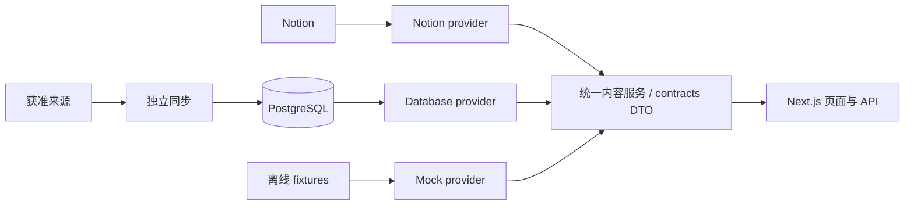

# NotionBlog

**在 Notion 写作，用自己的网站呈现。**

NotionBlog 是以 Notion 为内容后台的个人网站，将动态、层级学习笔记、作品库和社交作品汇入独立的阅读与浏览体验。内容来源、栏目和个人资料均可配置，前端通过统一契约取数。

基于 **Next.js 16 · React 19 · TypeScript · PostgreSQL**。当前处于持续开发阶段，尚未发布稳定版本。

[快速开始](#快速开始) · [接入内容](#接入自己的内容) · [架构](#架构与目录) · [文档](docs/README.md) · [公开准备](docs/PUBLIC_READINESS.md)

## 功能

- **个人时间线**：动态与获准的社交作品混排，支持分页、年份浏览和作品合集。
- **层级学习笔记**：按学习项目、学期、课程组织内容，保留多层目录、面包屑及笔记间导航。
- **丰富的阅读体验**：正文 AST、代码高亮、数学公式、图片预览与看大图。
- **作品与收藏**：游戏、影视、书籍、相册等共用内容接口，按配置启用。
- **多套主题**：墨水、苹果、千禧与岛屿主题，以及适用主题的明暗模式。
- **可替换的内容服务**：离线演示、Notion 直读和 PostgreSQL 读取使用同一组 DTO；独立同步程序负责采集与发布。
- **明确的公开边界**：来源、页面、祖先关系、媒体及撤回遵守对应发布策略；真实服务失败时明确报错。

## 快速开始

建议使用 **Node.js 24 LTS** 与 npm；完整 Node 版本约束见 [package.json](package.json)。

```sh
git clone https://github.com/jimmyhuang22/NotionBlog.git
cd NotionBlog
npm ci
npm ci --prefix scripts/game-sync --ignore-scripts
npm run dev
```

打开 [http://127.0.0.1:3000](http://127.0.0.1:3000)。默认运行离线演示，包含虚构内容和本地图片，**无需 Notion Token、数据库或云账号**。首次安装依赖需要访问 npm registry。

普通开发、测试、本机构建与启动均使用隔离入口，已有生产 `.env.local` 不会自动启用真实连接。演示内容用于体验功能，不代表个人站点的实际数据。隔离机制及真实联调方式见[开发隔离说明](docs/DEVELOPMENT_ISOLATION.md)。

```sh
npm run dev -- --port 3100  # 使用其他本机端口
npm run check             # 类型、协议、测试与源码隐私检查
npm run build             # 生产构建与服务端文件追踪隐私检查
npm start                 # 启动本机构建，仍为隔离演示
```

游戏平台同步有独立锁文件，因此完整验证前也需要安装其依赖；体验网站不需要配置或运行同步任务。

## 接入自己的内容

| 方式 | 适用场景 | 接入说明 |
| --- | --- | --- |
| `mock` | 体验页面、前端开发、离线回归 | 默认启用，无需凭据 |
| `notion` | 验证来源字段、正文和公开规则 | [Notion 接入](docs/NOTION_SETUP.md) |
| `database` | 网站读库，采集与访客请求分开 | [数据库接入](docs/WEBSITE_DATABASE_SETUP.md)、[同步程序](docs/NOTION_SYNC_WORKER.md) |

真实连接需按接入指南显式配置；仅修改普通开发环境中的 `CONTENT_PROVIDER` 不会绕过离线隔离。来源授权、同步发布、网站读取和媒体访问分别验证，不能以某一步成功代替整条链路验收。

### 个人资料与学习项目

配置格式见 [config/site.example.json](config/site.example.json)，实际配置保存在忽略的 `config/site.json`，或服务端环境变量 `SITE_CONFIG_JSON` 中。支持站点名称、简介、头像、社交链接、时区，以及在页脚显示的 `notionSiteUrl`；`studyProjects` 可配置学习项目、课程分配和按学期或内容入口组织的布局。

未配置个人资料时使用通用身份。离线演示使用隔离的演示配置；个人配置的真实展示按联调与部署指南启用。

来源映射见 [config/notion-sources.example.json](config/notion-sources.example.json) 与 [config/notion-website.example.json](config/notion-website.example.json)。栏目开关和公开资格独立：**在导航中启用栏目不等于批准其所有来源和页面公开**。

### 同步与部署

网站服务只取得受限读取能力；内容采集、游戏平台同步、社交采集和媒体处理使用独立程序及各自凭据。运行前先阅读[文档导航](docs/README.md)中的对应操作说明。

当前托管接入以 Vercel 为主，数据库使用 PostgreSQL，媒体通过独立存储适配访问。普通 `npm start` 是本机演示入口；其他托管平台的真实生产启动仍需显式适配，不能当作开箱即用的部署模板。上线、迁移与回退边界见[部署试验说明](docs/VERCEL_SUPABASE_TRIAL.md)及[重构交接](docs/REFACTOR_ROLLOUT.md)。

## 架构与目录



图片通过独立的服务端媒体适配访问来源或私有存储。

| 路径 | 职责 |
| --- | --- |
| `contracts/` | 内容 DTO、正文 AST、列表、学习树与时间线契约 |
| `src/lib/content/` | 页面与 API 使用的统一内容入口 |
| `src/server/` | Notion、数据库、公开资格和媒体的服务端实现 |
| `src/app/`、`src/components/` | 路由、页面、主题和交互组件 |
| `scripts/` | 内容、游戏、社交与媒体等独立任务，以及开发验证工具 |
| `database/`、`supabase/migrations/` | 数据库协议、受限权限与增量迁移 |
| `adapters/`、`fixtures/`、`public/mock-media/` | 模拟服务、虚构数据与演示素材 |
| `config/` | 不含真实个人值的配置示例及栏目定义 |
| `tests/` | 契约、权限、同步、读取与隐私回归 |

Notion SDK、Token、原始响应和真实来源映射只在服务端使用。未知日期、评分和封面保留 `null`，不会用演示数据补齐真实数据。

## 项目状态

网站、内容服务、同步模块和媒体能力已持续实现并用于真实站点验证。部分增量发布、搜索和页面缓存能力有独立安装步骤与开关，**代码存在不代表每个环境都已启用**。当前优先完成个人站点，尚未提供自动建库、多租户后台或一键部署平台。

功能与配置以当前代码及对应操作文档为准；阶段验收见 [docs/progress/](docs/progress/README.md)，已确认的取舍见 [docs/decisions/](docs/decisions/README.md)。历史验收记录不是新环境的可用性保证。

## 参与开发

开始前阅读 [AGENTS.md](AGENTS.md)、[项目需求](docs/REQUIREMENTS.md)及近期决策和进度。页面只消费统一 DTO，避免直接读取 Notion 原始属性或私人配置。

应用改动运行 `npm run check` 与 `npm run build`；纯文档改动核对记录格式、链接、差异和隐私。提交前还需检查暂存版本：

```sh
npm run privacy:check -- --staged
git diff --cached --stat
git diff --cached
```

按项目约定通过短期分支和合并请求协作；集成与发布流程见 [AGENTS.md](AGENTS.md)。反馈问题时提供复现步骤、Node 版本及脱敏错误信息，勿上传 `.env`、真实来源、数据库导出或个人正文。

## 隐私与许可

真实配置、凭据、个人记忆和私有资产放在忽略目录或托管平台的服务端环境中。`privacy:check` 检查当前候选文件；它不能代替 Git 历史、提交元数据及 GitHub 日志审查。具体要求见[隐私约定](docs/PRIVACY.md)与[公开准备报告](docs/PUBLIC_READINESS.md)。

本仓库已完成同名切换，使用独立的干净 Git 历史，当前仍保持私人并进行公开前验收。项目原创源码采用 [MIT 许可证](LICENSE)。个人内容、头像、真实站点内容不随源码自动授权；第三方依赖、字体和媒体保留各自许可。实际公开仍须完成最终验收。
