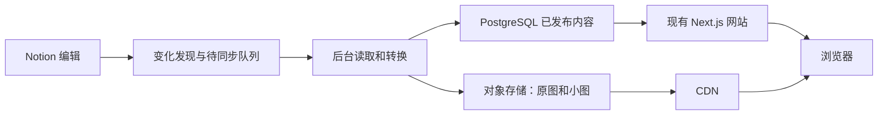

# 内容架构重新分析

分析日期：2026-10-13。状态：用户已确认实施方向；旧分支已整合，独立持久发布为首个开发阶段，线上仍使用原运行模式。

最初分析基于 main 的 `93031d1`、实际源码、既有运行和迁移盘点回执，以及 Notion、腾讯云官方文档；实施基线已整合到 develop 的 `b49ca0c`。未重新采集 Notion、导出线上正文、下载全库图片或触发发布。历史数量、时长与媒体覆盖只作为已有证据，不当成本次新鲜全库测量。

## 建议与边界

首选保留 Notion 的编辑能力，网站以自有 PostgreSQL 的已发布数据和独立对象存储为访问来源。同步程序负责把编辑变化转换成网站数据；访客请求不访问 Notion。完全自行开发编辑后台可在这个结构稳定后逐项替换。

用户正在考虑退出 Notion，也希望评估“继续在 Notion 写内容，程序定时查增量并同步到博客数据库”。用户随后确认先整合所有现有分支，再开始这套方案的实施；新模式和对象交付验收完成前不发布到 main，不创建 COS 或停止已有任务。

需要分别决定四件事：在哪里编辑内容、网站保存什么数据、文件由谁交付、网站和数据库托管在哪里。更换对象存储不能自动消除 Notion 实时依赖；更换数据库云厂商也不能自动实现增量同步。

## 已有工程与目前的缺口

| 层 | 已有能力 | 应调整的部分 |
| --- | --- | --- |
| 页面与组件 | Next.js、主题、列表、阅读、搜索、学习目录和灯箱 | 继续消费既有 DTO；无需为了替换数据来源重做页面 |
| 内容契约 | 十类内容、父子关系、正文 AST、空值和统一接口 | 保留；增加存储模式时维持接口兼容 |
| 网站数据库 | PostgreSQL 网站 v2，保存结构化条目、正文、媒体描述和发布批次 | 当前属于受来源资格约束的发布副本，需要独立、持久的发布语义 |
| 内容同步 | 来源映射、范围检查、批次暂存、原子发布、锁和回执 | 当前仍遍历选中来源并读取每页完整正文；需要记录级增量与断点 |
| 图片 | 原件镜像、强条件请求复用、格式转换、按需缩略图 | 原图仍部分依赖 Notion；小图请求仍实时核验来源并由网站代理交付 |
| 游戏账户 | 平台采集、隐私排除、作品匹配、变化写入 | 当前经过 Notion 中转；自动字段可逐步直接进入网站数据库 |
| 社交采集 | 独立 SQLite 暂存与 PostgreSQL 受限接入 | 已有绕过 Notion 的结构；继续区分作品发布、采样新鲜度与隐私撤回 |

源码依据：`contracts/content.ts`、`src/server/notion/website-repository.ts`、`scripts/website-sync/worker.ts`、`database/website-migrations/001_website.sql`、`src/server/media/thumbnail.ts`、`src/server/notion/media-source.ts`。

当前 `collectRecords(true)` 按来源和页面遍历并读取正文，worker 随后把整批记录暂存和发布。图片条件请求复用降低图片下载量，但不能省掉这段正文采集。历史完整运行约一小时的证据不能当成增量方案必需耗时。

数据库 `records` 已保存 `item` 和 `document` 的 JSONB，但按 `run_id` 属于整批快照；`current_snapshot()` 会检查批次 `valid_until`。当前有效期是来源资格约束，不能简单删除检查或无限续期来冒充独立内容库。推荐另设明确的发布模式或迁移版本，同时保留旧模式的保护和回退能力。

## Notion 的实际价值

Notion 目前承担表格录入、筛选视图、富文本编辑、课程层级、关系及汇总，还有人工内容与自动账户记录的维护入口。它提供现成数据，也提供持续编辑这些数据的工具。

正文包含代码、公式、表格、多列、嵌套列表、折叠块与子页面。因此，完全退出 Notion 的新增工作主要在编辑器、关系与派生字段维护、附件管理和发布管理。数据库本身已具备基础。

| 方案 | 日常编辑 | 工程影响 | 适用判断 |
| --- | --- | --- | --- |
| Notion 编辑，网站独立读取 | 沿用现有工具 | 重做同步与交付，保留页面和契约 | 当前首选，能先解决性能与可用性 |
| 网站后台完全编辑 | 建设或接入管理界面和富文本编辑器 | 还需编辑、草稿、附件、版本与关系维护 | 在确定需要替代 Notion 编辑体验后推进 |
| 按内容类型分开 | 学习和长文留 Notion，平台统计直接入库 | 需要每类字段的唯一维护来源 | 很适合后续游戏平台与社交数据 |

首选方案也允许以后退出 Notion：网站稳定主键与来源映射分开，Notion ID 只保留为导入来源，不承担永久发布资格。

## 批量迁入能覆盖什么

现有网站范围已经完成过千级记录的数据库同步，包含动态、游戏、影视、书籍、相册、一门课程及其学习节点、关于单页。批量导入不是新的可行性障碍，但已有网站投影不能等同于全部私人后台数据。

| 数据 | 推荐迁移方式 | 必须保留的语义 |
| --- | --- | --- |
| 标题、状态、标签、日期、个人评分 | 类型化字段或类型扩展表 | 空值、零值、日期精度和个人字段 |
| 正文 | 继续使用现有 AST，保存为 JSONB | 已支持块与明确的 partial 标记 |
| 课程、周次、活动和知识页 | 主键、父键、课程键和排序 | 层级、内部链接与逐节点公开范围 |
| 游戏版本和平台记录 | 作品、版本、平台产品及账户记录分别建模 | 时长单位、来源、账户隐私排除和人工状态 |
| 关系、公式和汇总 | 关系表、查询或派生逻辑 | 当前计算值和计算规则分别处理 |
| 原图、缩略图及附件 | 验证后保存实际文件并建立资产表 | 文件摘要、尺寸、归属和版本 |

公开 DTO 不包含所有原始属性，例如游戏的外部产品身份、版次核查和来源维护信息。完全替代私人作品库之前，应从已有私人盘点或指定来源补齐这些字段，而不是把网站展示投影直接称为完整迁移。

Notion 的文件链接会过期，必须保存实际字节，不能把临时链接当永久图床。[文件说明](https://developers.notion.com/guides/data-apis/retrieving-files)

Notion 的页面正文与属性分别读取，关系和汇总的完整结果也需要处理分页；界面中的公式、筛选视图与编辑行为需要在目标系统重新表达。对 API 不支持的块及已知 partial 页面逐项列出缺口，必要时辅以选定页面的 HTML/Markdown 导出。[正文读取](https://developers.notion.com/reference/get-block-children)、[属性读取](https://developers.notion.com/reference/retrieve-a-page-property)、[官方导出](https://www.notion.com/help/export-your-content)

私人迁入范围与网站公开范围分开。未公开课程或后台核查字段可以在获准后私人导入，不因此成为网站内容。

## 推荐数据流

访客路径不连接 Notion。同步失败影响更新及时性；在明确的新发布政策下，已批准内容仍可服务。确认删除、中央下架、公开范围撤回和权限异常需要独立处置，不能把上游无法连接解释为继续公开一切。

网站数据库建议分开保存内容主记录、正文、层级关系、媒体资产、来源映射、同步任务和发布状态。第一阶段无需把每个正文块拆成 SQL 行；正文继续使用 AST，筛选和排序字段建立适当索引。

## 真正的增量同步

初次建立基线后，只采集变化页面、受影响关系及新增或变更媒体。优先复用已验证快照、原件镜像和缩略图；旧证据只能作候选依据，实际使用前按所需范围校验。

1. 接收并验签 Notion Webhook，把页面键和变化类型入队，持久保存事件与去重信息。
2. 定时处理队列，并补查数据库行和已纳入普通页面的变化；同一页短时间内多次编辑合并处理。建议先以五分钟处理周期为候选，实际时效以运行测量为准。
3. 重新读取变化页面的当前属性和完整正文；子页面独立追踪，关系和派生字段变化使受影响内容重新计算。
4. 图片来源未变时复用资产；新增或变化才下载、核验与生成必要尺寸。临时签名刷新不当成文件内容变化。
5. 按内容及媒体准备完毕的条件事务更新发布版本，刷新受影响查询与媒体缓存。
6. 定期做来源目录、成员身份、祖先与资格的补查，发现漏事件、移出来源、删除及权限变化；补查不默认重读全库正文和全量下载图片。

Notion 官方支持页面内容、属性、新建、移动和删除等通知。事件可能聚合、延迟或乱序，只是变化信号；程序仍要取最新实际数据。不能以通知到达时间承诺即时完整同步。[Webhooks](https://developers.notion.com/reference/webhooks)、[事件与投递](https://developers.notion.com/reference/webhooks-events-delivery)

轮询可作为独立的起步方案，但只比较课程父页面的编辑时间无法证明全部子页面不变；也不能靠“修改时间晚于检查点”的结果发现所有删除。学习普通子页、深层块、父级移动、来源 schema 和授权变化要单独覆盖。Webhook 加定时补查能降低持续全量读取的需要，仍须验收这些变化类型。

任务应保存最近成功检查点、页级版本和摘要、重试队列、媒体处理状态。重复事件和中断后继续不重复上传。网络超时、限流、未知权限和明确删除分别处理；失败不得发布残缺新正文或自动扩大公开范围。

## 发布与缓存要一起调整

建议把 `last_synced_at` 和 `published/withdrawn` 分开。同步新鲜度用于显示状态与告警，不再凭整批同步时间直接让全部既有内容失效。这是用户已确认的实施方向，通过独立可选发布模式落实；旧模式的四小时资格保护保持，持久模式上线还须完成媒体、撤回及增量验收。

Notion 源端撤回由后台发现并更新发布状态；网站需有自己的紧急下架入口。图片可采用私有桶、CDN 回源权限和短期访问签名。签发地址时读取网站发布资格，图片由 CDN 交付。浏览器缓存时间不超出所选访问窗口。

源端撤回到网站停止访问的时间包含变更发现、处理与已经签发地址的剩余有效期；缓存刷新也有传播时间。已下载到用户设备的字节无法追回，不能承诺绝对即时撤回。具体时限须结合所选更新与撤回政策确认。

腾讯 COS/CDN 支持私有回源和边缘鉴权；中国内地加速涉及域名备案。存储及加速厂商和区域另行选择，以国内、海外代表网络实测为依据，不凭厂商名称保证速度。[COS 与 CDN](https://cloud.tencent.com/document/api/436/18669)、[CDN 鉴权与缓存](https://intl.cloud.tencent.com/zh/document/product/228/35225)、[加速区域与备案](https://intl.cloud.tencent.com/zh/document/product/228/32978)

## 其他程序如何简化

平台自动统计可逐步从“平台 → Notion → 网站数据库”改为“平台 → 网站数据库”。人工评分、体验状态和心得仍由选定的编辑入口维护；平台时长、奖杯与账户数据不能覆盖这些人工字段。若仍需在 Notion 查看自动统计，可单向回写展示，不建立双方都能编辑同一字段的循环。

社交采集已有独立数据库方向，继续沿用即可。优先确认原平台访问能力、固定目标、采样新鲜度与发布范围，不能把技术改造当成全账户公开授权。

数据库、对象文件和同步状态分别备份。网站的稳定运行不应要求 Mac mini 持续在线或 Notion API 每次可用；执行端停止时，更新状态应可观察，访问行为按新的明确发布政策执行。

## 实施顺序与验收

1. 以用户已确认的独立发布方向开发基础，保留现有状态作为切换基线。源端撤回时限及额外私人导入范围在具体接入前确认。
2. 增加可独立服务已发布内容的存储模式与媒体交付，复用现有页面、DTO、AST 和资产；在隔离环境中阻断 Notion 网络，验证代表页面与图片仍正常读取。
3. 实现变化队列和增量执行器，以新增、编辑、深层子页、关系变化、删除、权限异常和断点重试为验收场景。一次修改只处理变化内容，无变化不上传图片。
4. 用指定媒体小样本对比冷请求和 CDN 命中，确认收益后分批迁移。上线时只做必要代表验收，避免重复全站逐篇读取和全图下载。
5. 再决定是否逐类增加网站编辑后台，并把平台统计直接接入数据库。

数据库模式和图片性能是第一优先级；重建完整 Notion 编辑器、同时迁移所有云服务和建设多租户平台不在首轮建议范围。现有代码中的限流、文件校验、范围控制、导入幂等与备份组件仍有价值。

待实施时验证：页面访问的 Notion 请求数为零；一页编辑只同步该页和必要依赖；未变化媒体不下载或上传；来源删除和权限变化正确阻断；学习未批准子页不继承公开；失败后上一已批准版本按新政策服务；代表冷/热读取有实际时延记录。

首个实现已提供独立、显式启用的持久发布指针、受限读写及 Mac mini 入口，详见 [发布模式](CONTENT_PUBLICATION.md)。本阶段保留整批采集，不代表页级增量、独立缩略图／CDN 或线上切换已完成；没有改变定时任务或云端配置。
