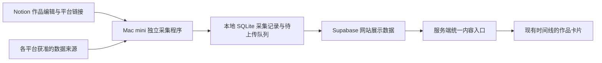

# 社交视频时间线：构思与接入候选

阶段：2026-10-11 头脑风暴；2026-10-12 按用户后续授权完成 7 条真实样本的采集、本地 SQLite 与云端临时传输验证，见 [账号测试结果](SOCIAL_ACCOUNT_PROBE.md)。永久存储、网站接入与调度尚未实现或启用；尚未申请社交平台的新应用权限。

网站、数据库与执行端的整体分工，以及 Mac mini 四类业务任务与维护任务的建议，见 [系统架构](SYSTEM_ARCHITECTURE.md)。

实施前的现有项目、许可证及源码边界核对见 [GitHub 项目选型调研](SOCIAL_PROJECT_RESEARCH.md)。当前推荐自建同步核心、按需复用平台读取模块；尚未选定新的生产依赖。

## 已确认的展示偏好

- 希望在现有时间线展示本人发布的小红书、B 站视频，未来考虑抖音。
- 同一作品的多平台发布合并为一张作品卡片，各平台的链接和互动数量分别展示。
- 评论先显示数量，点击原平台查看；当前不采集或展示评论原文。

具体账号、历史收录范围、新作品自动公开规则、同步周期和播放方式仍待选择。已有 Status 的整来源规则不授予社交来源公开资格。

## 推荐的候选结构

Notion 适合维护作品标题、简介、自有封面、跨平台关联与网站展示选择；频繁变化的统计由采集程序直接写到云端，避免每次刷新统计都改 Notion。是否新建作品来源尚未确认，也可以先用少量人工登记的作品与链接验证流程。

Mac mini 负责平台适配、本人授权会话、限流、错误记录和重试。SQLite 负责本地采集记录、检查点及待上传任务；云端不可达时可以先存下来，恢复后按稳定标识重试。它不必与 Supabase 做双向整库复制。网站只读已获准的云端数据，访问页面不会触发平台采集。

能够完全经官方 API 接入的平台，后续也可把采集任务移到云端；需要本机授权会话的平台保留在 Mac mini。统一输出契约使两种执行方式可以共存。采集器与现有 Notion worker 分开，不把此功能塞入冻结同步 v1。

## 三条路线比较

| 路线 | 适合的阶段 | 主要成本或限制 |
| --- | --- | --- |
| 人工登记作品与发布链接，统计可选 | 最小试验，先验证卡片与跨平台关联 | 新作品和统计需要人工补充；基础展示不依赖全自动采集 |
| Mac mini 采集，本地暂存，上传云端 | 当前推荐的候选，可按平台逐步增加自动化 | 需要维护授权会话、任务运行和失败重试 |
| 云端定时调用官方 API | 权限与实际返回均已验证的平台 | 依赖应用准入、用户授权和平台额度；不能替代不提供所需 API 的平台 |

第三方数据服务也能作为独立适配器评估，但不能仅凭宣传认定字段准确、账号安全或长期可用。个人规模优先验证官方路径与人工导入，再决定是否支付额外服务费用。

## 官方能力核对

| 平台 | 已核对的官方信息 | 接入时仍须证明 |
| --- | --- | --- |
| B 站 | 官方开放平台列出账号授权、视频稿件查询与授权后的稿件数据开放 | 当前应用与个人账号是否可取得权限；具体统计字段、存量稿件覆盖与分页完整性 |
| 抖音 | 视频数据接口要求申请权限和用户授权；示例包含播放、点赞、评论、分享与转发，文档只返回公开视频数据 | 当前可申请的应用类型与能力；视频发现、存量覆盖、字段语义及本人账号实测 |
| 小红书 | 公开文档涵盖账号登录、内容分享 SDK 与营销 API；这些能力不能直接等同于普通创作者全量笔记统计读取 | 是否有适用本人账号的获准读取能力；逐笔记统计、分享数、历史范围和实际字段精度 |

资料：[B 站开放平台](https://openhome.bilibili.com/doc)、[抖音视频数据接口](https://open.douyin.com/platform/resource/docs/openapi/video-management/douyin/search-video/video-data)、[小红书账号 API](https://openaccount.xiaohongshu.com/docs/api-reference)、[小红书分享 SDK](https://agora.xiaohongshu.com/doc/js)、[小红书营销平台接入指南](https://ad-market.xiaohongshu.com/docs-center?articleId=3197&bizType=1084)。

小红书已在既有浏览器会话下读取图文样本的点赞、收藏、评论及分享数量；匿名 HTTP 会转到登录页，当前加载内容尚无视频样本。后台导出、完整历史、视频分支与无人值守运行仍待验证，不能承诺已经存在可用导出。页面采集可能需要重新登录并随页面变化维护；遇到权限、验证或限流停止自动任务，由本人处理。

## 数据与展示建议

逻辑上分三类数据，以下名称不是已经落地的 SQL 或 DTO：

| 数据 | 内容 |
| --- | --- |
| 作品 | 网站标题、简介、封面、标签、真实首发日期或明确编辑日期、展示选择 |
| 平台发布 | 关联作品、平台及账号身份、稳定发布 ID、原链接、平台标题、发布时间、可见性 |
| 统计采样 | 平台发布标识、采集时间、数据来源、成功取得的互动计数与精度 |

- 平台发布用平台、账号、稳定发布 ID 去重；作品关联首版人工确认，标题相近不能自动合并。
- 卡片使用真实首发时间或用户明确的作品日期。不同平台补发只增加入口；互动刷新不生成新时间线事件，也不改变排序。未知日期保留为空。
- 点赞、评论、收藏、投币、弹幕、分享、转发等各自保留原语义与平台标签，不混成统一的热度或独立观众数。来源只返回“1.2万”时保留显示值与近似精度，不能声称精确计数。
- 无权限、不支持和未知计数保留为空；真实零保留为零。失败不覆盖上次成功统计，不伪造新的采集时间，不把计数假定为只能增长。
- 统计新鲜度与公开资格分开管理。旧统计可标注更新时间，但仅在展示资格仍有效时读取；明确删除或转私密时停止该平台入口及其媒体，其他已获准平台可以保留。网络错误、权限丢失和列表暂缺不能伪称删除；资格无法确认或过期时按独立规则受控停止展示。
- 统计上传须可重复执行，并防止较旧的重试覆盖新采样；保留失败任务和检查点，成功上传后才确认完成。
- 第一版推荐展示自有或获准封面、简介与原平台链接。站内播放器另按平台官方能力验证，采用点击后加载；自托管自己的视频原件可作为后续独立选择。
- 凭据、Cookie、原始响应及私有账号资料留执行端；云端只保存必要的展示与同步信息。云端采集写入、网站只读与人工下架能力分别限权，参考 [Supabase API 访问控制](https://supabase.com/docs/guides/api/securing-your-api)。

刷新可先试每日一次；新作品首周较频繁、旧作品较稀疏只是候选，须按实际数量、额度和执行时间确定。发现新作品、验证可见性与刷新计数不必使用同一周期。

## 建议的验证顺序

1. 用少量人工确认的作品及跨平台链接验证卡片、关联和真实发布时间；没有统计时仍可展示基础内容。
2. 先核对 B 站官方权限和代表稿件数据，再做有界采集、重复上传、离线补传及删除／转私密样本验证。
3. 为小红书单独验证本人账号可用的读取方式。允许其先提供基础信息与部分统计，不以三家字段齐全为上线前提。
4. 实际发布到抖音后再验证对应授权与历史发现方式，复用作品关联与统一展示契约。

只读来源与样本传输已取得阶段证据，后续应先验证可重复采集、会话、分页、作品关联及 B 站合集口径，再选择永久实现与公开范围。本轮仅运行私人样本脚本和会话临时 SQL；没有永久数据库迁移、调度、前端修改、账号写入或网站发布。
