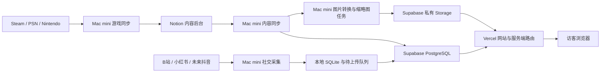

# 网站与 Mac mini 任务架构

2026-10-12 架构梳理。以下区分已有模块、已验证样本和后续建议；不是正式环境或调度已经启用的声明。社交功能依据见 [探索方案](SOCIAL_VIDEO_EXPLORATION.md) 与 [样本测试](SOCIAL_ACCOUNT_PROBE.md)。

## 各层分工

| 位置 | 责任 | 保存或处理的数据 |
| --- | --- | --- |
| Notion | 人工内容后台 | 动态、学习与已获准栏目；游戏作品的人工信息与平台记录。社交作品编辑来源仍是候选 |
| Mac mini | 采集、加工、上传和维护 | 平台适配、私有会话、采集检查点、待上传队列、图片转换与备份 |
| Supabase PostgreSQL | 网站统一读取的数据 | 已获准内容快照；未来的社交作品、平台发布与统计采样 |
| Supabase 私有 Storage | 文件存储 | HEIC 转换图、WebP 缩略图；未来获准的社交封面 |
| Vercel | 运行 Next.js 网站与服务端路由 | 页面、内容查询、权限检查和图片交付；平台采集由独立任务完成 |

Vercel 可以同时承载页面和服务端逻辑，见 [Next.js 官方部署说明](https://vercel.com/docs/frameworks/full-stack/nextjs)。Supabase 提供 [PostgreSQL](https://supabase.com/docs/guides/database/overview) 和有访问控制的 [私有文件桶](https://supabase.com/docs/guides/storage/buckets/fundamentals)。数据库与文件分别存储，SQLite 仅作执行端暂存，不做整库双向复制。

图中的图片箭头表示数据流程，不表示缩略图已自动接入内容同步。当前普通 Notion 图片另由网站核验后返回动态原图地址，浏览器直接读取来源；HEIC 转换图及启用后的缩略图使用私有 Storage。图片路由在网站中，Mac mini 无需为博客另开 HTTP 图床。

## Mac mini 的任务数量

建议按四类业务任务管理，再加一类维护任务。任务数量不等于常驻进程数量：定时入口可使用 macOS launchd，任务执行完退出。

| 任务 | 方向与运行方式 | 当前阶段 |
| --- | --- | --- |
| 内容同步 | Notion → Supabase；独立、有界的完整采集与发布 | 已有模块和实际验收；周期调度未启用 |
| 游戏平台同步 | Steam／PSN／Nintendo → Notion；一个程序的多个适配器 | 已有模块及真实采集／dry-run；每次写入仍需满足当前隐私和计划条件 |
| 社交内容采集 | 平台 → SQLite → Supabase；作品发现与统计刷新可分频率 | 七条跨来源样本已通过本地与云端临时传输；永久实现、自动运行尚未完成 |
| 图片加工 | 转换格式、生成 400／800px WebP → 私有 Storage | HEIC 转换在内容流水线内；缩略图目前是独立有界命令，样本验收通过，尚未接入周期 worker |
| 备份与健康检查 | 数据与媒体备份、最近成功时间、网站可用性 | 归档／恢复已有验证；统一周期维护和告警仍需安排 |

仅就博客运行需求，Mac mini 必须常驻并对外提供的 HTTP 服务数量为零。SQLite 不需要数据库守护进程；本机 PostgreSQL 与 Next 开发服务器是开发／演练用途。其他 HomeLab 已有服务不计入博客任务数量。

内容同步完成后，缩略图任务须按同一有效批次串行登记；不能在共享 writer 会话或维护锁上并发抢占。图片加工可以共用转换组件，但不据此合并不同任务的凭据或扩大来源权限。现有缩略图边界见 [图片预览副本](MEDIA_THUMBNAILS.md)，现有运行与候选调度见 [固定同步运行](SYNC_RUNTIME.md) 和 [调度候选](SYNC_SCHEDULE.md)。

Mac mini 停机首先导致数据无法更新。网站实际是否仍可读取旧内容，取决于该数据的公开资格、来源可达性和过期规则；当前 Notion 快照资格过期会受控拒绝，不能承诺永久离线可读。社交统计的新鲜度应与展示资格独立设计。

## 社交采集器第一版

建议先实现可手动运行的独立程序：受控作品与链接输入、B 站适配器、本地 SQLite 采样／待上传队列、可重复上传与运行状态，再接永久 Supabase 存储和网站统一入口。每一步形成可单独验收的结果，最后再启用周期运行。

跨平台作品先人工关联，网站合成一张卡片，分别展示各平台指标和链接。统计刷新不改变作品日期；评论仅保留数量、点击原平台查看。Steam 继续由游戏同步程序管理，避免另建第二条游戏数据写入路径。

小红书既有会话已验证图文读取，视频、完整历史及无人值守会话仍需补测；适配器可先支持人工登记、手动采集或导入。抖音预留适配器接口，实际账号与读取授权取得后再接入。第一版使用封面和原平台链接，站内播放及视频原件托管另行验证。

本次仅记录架构与建议，没有安装任务、改变凭据、写入永久社交表、修改前端或启用公开来源。
