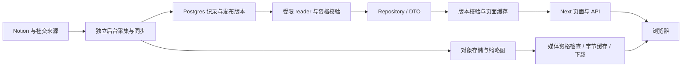

# 后端架构与性能审查（2026-11-11）

本报告保留实施前的发现与测量；前三项后续修复见[实施记录](../progress/2026-11-11-backend-read-performance.md)。以下代码链接固定到审查基线。

本轮结论：已有分层、权限边界和有界读取值得保留；优先机会在缓存组合、重复数据库扫描和取消未传到底层 I/O。树算法存在明确的平方级复制，但属于后台同步路径。没有证据支持现在重写后端、引入微服务或直接放大连接池。

## 范围与证据

审查基线 `develop cf9bcfe71c3de6b87ce0d52c31adc975e3b6529d`，与 `main 5b85c49e2a491553662db7b27ed4aa583797d472` 文件树相同。读取代码、有关专题文档、安装的 Next 16.4.0 实现，并分别审查树算法、SQL 和请求编排。本轮不重新核验线上运行身份；私人后台运行包也未核对。

所有测量均在本机、合成数据下完成。主要环境为 Darwin ARM64、Node 24.21.0，SQL 使用已有 PGlite；缓存另在 Node 26.11.1 复验。没有项目数据库、Storage、Notion 或生产网站请求，项目云端流量为 0。查询官方公开文档和刷新 Git 引用不包含业务内容。本轮未改产品代码、依赖、契约、fixtures、配置、定时任务或发布状态。

## 当前架构

这是已有写入与展示分离的结构。当前 reader 同时承担资格验证、快照构造和应用层筛选；部分结果缓存叠在共享行缓存外面。问题主要发生在这些边界的组合。

## 1. 优先：嵌套缓存使社交基础数据无法按预期共享

证据：[共享行与外层作品缓存](https://github.com/jimmyhuang22/NotionBlog/blob/cf9bcfe71c3de6b87ce0d52c31adc975e3b6529d/src/lib/content/social-timeline.ts#L19)、[统一缓存端口](https://github.com/jimmyhuang22/NotionBlog/blob/cf9bcfe71c3de6b87ce0d52c31adc975e3b6529d/src/server/public-cache/runtime.ts#L18)、[首页外层缓存](https://github.com/jimmyhuang22/NotionBlog/blob/cf9bcfe71c3de6b87ce0d52c31adc975e3b6529d/src/lib/content/home-feed-v2.ts#L17)。两层都调用 `unstable_cache`。安装的 Next 16.4.0 `unstable-cache.js` 第 138、152 行会在 App Router 内识别嵌套，并跳过内层读取；内层仍可能写入。

因此不同筛选、cursor 或首页/作品查询的外层 key 未命中时，底层行数据会重复读取。同一个筛选再次访问时，外层缓存仍正常命中。这不是“全部缓存失效”。现有 `shared-social-rows.test.ts` 使用 Map 替身，未覆盖真实框架嵌套。

最小实验使用真实 Next 缓存函数、App Router async stores、实际 `readPublicProjection`，缓存存储和版本端口为内存替身：

| 三个不同筛选 | 底层行读取 | 版本读取 |
| --- | ---: | ---: |
| 现有嵌套，顺序或并行 | 3 | 12 |
| 独立基础缓存候选，顺序或并行 | 1 | 10 |

这证明调用次数差异，不是完整 HTTP 或线上延迟结果。

候选 A：保留页面结果缓存，把基础行放在独立、有容量上限的缓存中，以 namespace、发布版本和日窗口作为 key，合并在途读取；保留现有版本前后复核。共享加载需独立预算，分别处理等待者退出，不能继承首个访客的取消信号。候选 B：只缓存基础行，取消作品结果缓存；结构更简单，但重复访问会重新资格检查封面。候选 C：在外层缓存之外读取共享行；可能给外层命中增加克隆和检查成本。先比较 A/B 的完整请求 SQL 数、内存和取消行为，不能用 Next 私有上下文 API 强行绕过。

## 2. 优先：作品 SQL 对物化集合做逐作品重复扫描

证据：[timeline-repository.ts](https://github.com/jimmyhuang22/NotionBlog/blob/cf9bcfe71c3de6b87ce0d52c31adc975e3b6529d/src/server/social/timeline-repository.ts#L80) 将 publications 物化，随后第 95–98 行对每个作品做 `LATERAL` 子查询，按 `work_id` 从该 CTE 再筛一次。`retained-repository.ts` 复用同一结构；trial、retained 及 playback 变体都需验证。

设作品数 W、发布记录数 P，该部分存在 O(W×P) 扫描。合成 500 作品、每作品 20 条时，EXPLAIN 显示 CTE Scan 循环 500 次，每次排除 9,980 条无关记录，共约 499 万次排除。给来源表加索引并不能直接给已经物化的 CTE 建索引。

| 合成数据 | 原 SQL 中位数 | 一次分组 + 窗口候选 |
| --- | ---: | ---: |
| 50 作品 / 1,000 发布记录 | 7.20 ms | 4.81 ms |
| 500 作品 / 10,000 发布记录 | 300.70 ms | 42.59 ms |

实际导出的 SQL，预热后各 3 次取中位数；完整输出一致，并覆盖超过 20 条的哨兵与无发布记录的合集。实验使用合成表承接视图名称，未测生产视图/RLS成本、网络或并发。

候选 A：保留物化和资格结果，按 work_id 一次分组，用 `row_number` 保留每组前 21 条（20 条上限 + 超限哨兵），然后连接候选作品。候选 B：允许内联并依靠下层索引；可能重复计算 RLS/视图，不能仅删除 `MATERIALIZED` 就认为更快。优先验证 A 的全部权限/合集变体，再决定是否采用。Postgres 文档也说明物化会限制条件下推，是否内联应比较完整计划：[CTE 物化](https://www.postgresql.org/docs/current/queries-with.html#QUERIES-WITH-CTE-MATERIALIZATION)。

## 3. 优先：媒体请求取消后，内容对象下载继续运行

证据：[媒体预算](https://github.com/jimmyhuang22/NotionBlog/blob/cf9bcfe71c3de6b87ce0d52c31adc975e3b6529d/src/server/media/read-budget.ts#L5) 默认 8 秒；[Supabase 下载](https://github.com/jimmyhuang22/NotionBlog/blob/cf9bcfe71c3de6b87ce0d52c31adc975e3b6529d/src/server/database/storage.ts#L59) 和 [COS 下载](https://github.com/jimmyhuang22/NotionBlog/blob/cf9bcfe71c3de6b87ce0d52c31adc975e3b6529d/src/server/database/cos-storage.ts#L64) 只使用独立 20 秒信号。外层 `Promise.race` 结束等待，未将访客取消传给这两个内容媒体传输。后续 SQL 的预算仍有效，所以不能说取消后继续查库。

调用实际存储函数、使用 100 ms 合成传输，在 20 ms 取消：外层约 23 ms 返回拒绝，两个原传输仍完成，分别持续约 115/104 ms；组合取消信号的候选在约 22/24 ms 中止传输，未完成对象下载。数字仅说明取消传播，不是网络提速。

非共享原图可以传递请求信号；共享缩略图要单独设计：下载持有自己的控制器，各等待者可独立离开，全部离开后才取消并驱逐。不能让第一个访客的取消连带失败其他访客。也可以保留共享下载的独立期限，但必须给在途对象数、字节和等待者设置总量边界。社交媒体已有请求信号包装，不能把内容路径的问题扩展为所有媒体路径。

## 4. 中期架构：列表有 cursor，但底层仍全量取元数据

证据：[loadMetadata](https://github.com/jimmyhuang22/NotionBlog/blob/cf9bcfe71c3de6b87ce0d52c31adc975e3b6529d/src/server/database/website-repository.ts#L107) 每次取 5,000 条、最多 20,000 条；[list](https://github.com/jimmyhuang22/NotionBlog/blob/cf9bcfe71c3de6b87ce0d52c31adc975e3b6529d/src/server/database/website-repository.ts#L254) 全量筛选排序后调用 [pageOf](https://github.com/jimmyhuang22/NotionBlog/blob/cf9bcfe71c3de6b87ce0d52c31adc975e3b6529d/src/lib/content/website.ts#L23)，cursor 编码的是内存 offset。不同页面结果 key 未命中时，重复全栏目 I/O，CPU 大致 O(N log N)，内存 O(N)。首页也有相似的全量索引选择路径。外层命中和同请求重叠读取合并可降低频次，但不改变 miss 的成本。

实际 repository.list + 合成 SQL executor：5,001 条记录，首屏 12 条与下一页 12 条，各自读取全部 5,001 条，两次 SQL，合成响应各约 2.47 MB。这里没有测数据库时延，也不包含真实记录体积。

方案比较：

- 共享同发布版本的紧凑元数据/有序索引，先减少重复 I/O；沿用原版本与撤回检查，设容量上限。
- 将筛选和排序下推 SQL，用稳定排序键与 ID、版本组成 keyset cursor，并配匹配索引。总数和年份统计要另设计，时区、null、评分排序及变更时的 cursor 语义必须保持。匹配 `ORDER BY + LIMIT` 的 B-tree 有机会只取需要的记录：[索引与排序](https://www.postgresql.org/docs/current/indexes-ordering.html)。
- 首屏 top-k 堆可把选择从 O(N log N) 变为 O(N log k)，但仍读全部 N 条；2 万项合成索引实测完整排序 44.91 ms，堆候选 31.62 ms，仅首屏一致性经过验证，深分页仍需扩大 k 或换游标。它不是当前首选。

已有 scoped 读取只为选中页补正文、filtered-scope 复用搜索资格，因此不应误写为“列表读了全部正文”或“搜索完全未优化”。课程目录也已每批 5,000 继续翻页，超过 20,000 明确拒绝，没有本轮猜测过的首批静默截断。

## 5. 后台算法：树邻接表平方级复制，增量仍做全快照 CPU 工作

证据：[descendants](https://github.com/jimmyhuang22/NotionBlog/blob/cf9bcfe71c3de6b87ce0d52c31adc975e3b6529d/src/server/notion/study-incremental.ts#L103) 每次扫描记录，用 `[...old, key]` 反复复制同父节点数组；复杂度 O(N + Σdegree²)，宽树退化 O(N²)。单次撤回还在第 118/121 行重复调用。第 255 行恢复应用同样拼接。

只将构造换为 push，调用实际 `prepareStudyDelta`，完整输出 deepEqual：

| 同父笔记数 / 单叶撤回 | 原实现 | push 候选 |
| --- | ---: | ---: |
| 1,000 | 49.49 ms | 49.20 ms |
| 5,000 | 251.90 ms | 228.67 ms |
| 15,000 | 938.05 ms | 670.45 ms |

大样本完整函数约减少 28.5%，小样本没有显著收益。纯构造局部收益更大，但不代表整轮同步收益。先用 Map + push，并复用同次子树结果即可，不需要引入平衡树。

更深层问题在第 87、92、183、185–197 行：全量验证、structuredClone、全部正文改写、多次规范序列化比较。一个没有变化的叶子信号虽只有一次 source.read，100/1,000/5,000 页（各 100 B 正文）仍分别约 10/52/271 ms。说明网络增量不等于 CPU 增量。

后续可比较按课程分桶与消除重复序列化、不可变记录 + dirty set、反向链接索引三档。反向索引需覆盖改名/移动/撤回与祖先变化；不能贸然跳过空 hrefChanges 的改写，因为现函数还规范化 `target:null` 子页。该函数由 `scripts/website-incremental-sync/study-domain.ts` 调用，不是网站请求；私人现役后台版本未核对。

## 6. 条件性缺陷：Supabase storage 实例生命周期破坏字节缓存

证据：[runtime storageFor](https://github.com/jimmyhuang22/NotionBlog/blob/cf9bcfe71c3de6b87ce0d52c31adc975e3b6529d/src/server/database/runtime.ts#L52) 只 memoize COS，Supabase/local 每次新建对象；[readThumbnailBytes](https://github.com/jimmyhuang22/NotionBlog/blob/cf9bcfe71c3de6b87ce0d52c31adc975e3b6529d/src/server/media/thumbnail-bytes.ts#L80) 用 storage 对象作为 WeakMap key。

实际缓存和 Supabase factory + 合成 fetch：同图连续 20 次，新实例每次创建造成 20 次下载；固定实例为 1 次下载、19 次命中，字节一致。runtime 整体未加载真实环境，适用于启用该 Supabase 缩略图分支的配置；COS 已稳定复用，不受这项影响，不能据此声称现站所有图片都未命中。

最小候选是按 provider/凭据配置在 runtime 内稳定复用实例；不要把不同身份的存储合成一个全局缓存。它与取消/共享下载问题应一起验证。

## 待观测或备用路径，不作为当前线上瓶颈结论

- [作品等待队列](https://github.com/jimmyhuang22/NotionBlog/blob/cf9bcfe71c3de6b87ce0d52c31adc975e3b6529d/src/server/social/read-queue.ts#L14) 没有队列长度上限，只有 deadline；大量等待时数组 shift、indexOf/splice 还有额外成本。先测队列长度、等待时间、拒绝率，再比较有界 deque/早拒绝；不要只增数据库连接数。
- SQL 每记录沿祖先链重新资格验证有重复工作。可比较同语句内根向下遍历/资格集合复用，但本机样本出现不同计划、收益不稳定。不能跨请求长期缓存正向资格，也不能删祖先撤回检查。
- direct Notion 备用 provider 的后代逐页 `await directPageDenied`，使微任务批量查询失效。实际 session + 合成端口，一课程 61 直属页使用满 64 次策略调用，62 页拒绝；数据库/hybrid provider 与同步 worker不走此预算。可先批量 prime 已取回的 child-page IDs，再逐层验父链，不应直接放大调用上限。

## 建议推进顺序与验收

第一批先做嵌套缓存、社交 SQL 分组、媒体取消三项独立小修；Supabase 实例生命周期可随媒体项验证。每项保留基线，验收输出/撤回一致性和真实调用次数，不以单项微基准代替页面收益。缓存至少覆盖真实 Next 上下文、不同筛选并行、版本变化及一个等待者取消；SQL 覆盖 retained/trial/playback、合集抑制、哨兵和权限；媒体覆盖单方取消、全取消和旧失败不驱逐新请求。

第二批才比较共享紧凑索引与 SQL 下推，衡量完整路径的 SQL 数、返回字节、p50/p95、内存和失败率。后台树 push 属低风险局部优化，可独立推进；dirty set/反向索引需单独设计。搜索专用倒排/n-gram、闭包表、Redis 或更复杂树结构暂未有充分证据成为最佳方案。

本轮只给出候选和证据，没有确定或实施最终方案，也没有执行全站生产压测。

## 本机复现材料

工作树忽略目录 `.local/backend-audit-20261111/` 保留脚本、候选副本、原始样本和 EXPLAIN：`read/` 为真实框架缓存与首页选择，`sql/` 为 SQL/PGlite 与列表计数，`tree/` 为实际增量函数，`media/` 为实际存储/缓存函数。公共 Git 记录仅为本文和对应进度；实验副本不替换产品源码。
